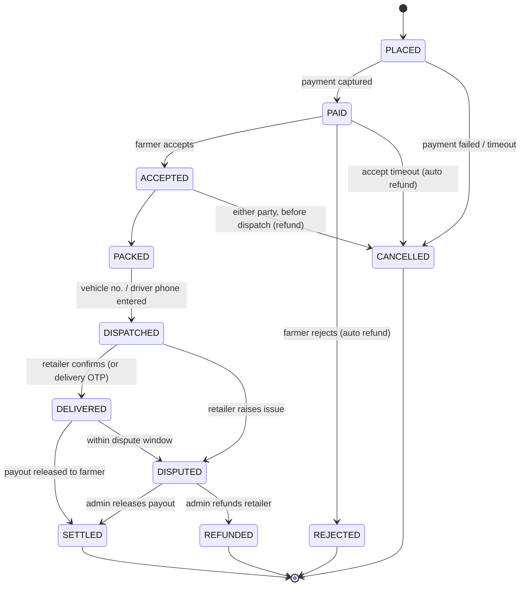
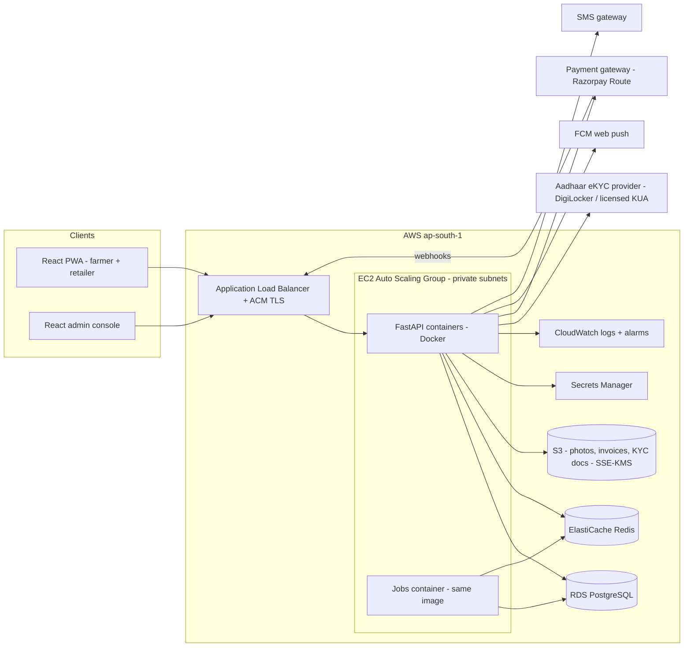
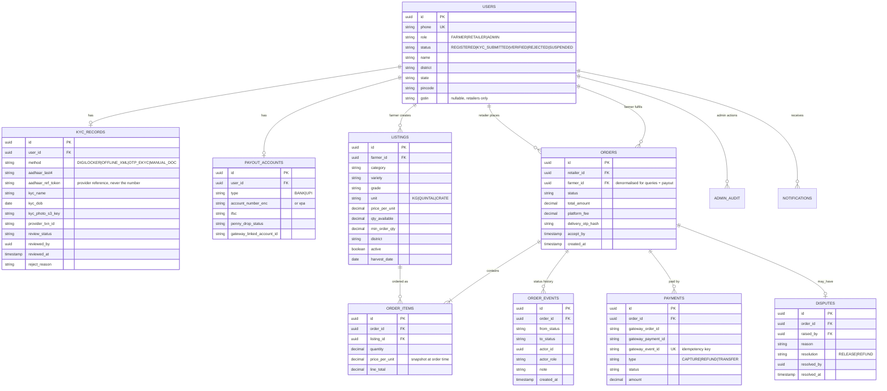

# Blueprint: Farmer–Retailer Order Management App ("KrishiLink")

| Item | Value |
|---|---|
| Version | 1.0 (merged blueprint — supersedes Agri.md and prior BLUEPRINT.md) |
| Scope | MVP: onboarding + Aadhaar-verified KYC, catalogue, orders, tracking, escrow payments, admin console |
| Clients | React PWA (farmers + retailers, role-based) + React admin console |
| Backend | Python 3.12+, FastAPI — modular monolith, Docker |
| Hosting | AWS EC2 (ap-south-1, Mumbai), Docker/Compose |
| Status | Proposed – open questions in section 13 |

---

## 1. Problem and goals

Farmers sell produce to retailers through middlemen, with no order record, no
delivery visibility and delayed payment. The MVP gives both parties one platform to:

1. Register and get **verified by an admin using Aadhaar eKYC** (trust between unknown buyers/sellers).
2. **List produce** (farmer) and **place orders** (retailer).
3. **Track** each order from placement to delivery.
4. **Pay online** (UPI/cards/net banking), with funds held in escrow and released to the farmer after delivery is confirmed.

Pilot: a small retailer network in one region.

**Out of scope for MVP:** logistics partner integration / live GPS, bidding/auctions,
credit/loans, AI matching, real-time chat, multi-language voice UI, analytics
dashboards, multi-farmer carts. (See section 12, Roadmap.)

## 2. Users and roles

| Role | Can do |
|---|---|
| **Farmer** | Register, submit KYC, add bank/UPI payout details, manage produce listings (price, quantity, unit, harvest date, photos), accept/reject orders, mark packed/dispatched, view payouts |
| **Retailer** | Register, submit KYC (+ optional GSTIN/shop licence), browse/search listings, place orders, pay, track, confirm delivery, raise a dispute |
| **Admin** | Review KYC queue, approve/reject/suspend users, view all orders/payments, resolve disputes, trigger refunds, manage produce categories |

Rule: **a user cannot list produce or place orders until `status = VERIFIED`.**
Unverified users can only browse.

## 3. MVP feature list

### 3.1 Onboarding and verification
- Mobile-number login with OTP (no passwords); SMS via MSG91 or AWS SNS (DLT-registered templates).
- Profile: name, role, address, village/district/state, PIN code, geo-location (optional).
- Aadhaar eKYC (section 6) → status `KYC_SUBMITTED`.
- Admin review → `VERIFIED` / `REJECTED` (with reason) / `SUSPENDED`.
- Farmer payout account: bank account + IFSC or UPI ID, validated by penny-drop via the payment gateway.

### 3.2 Catalogue (farmer)
- Create/edit/deactivate listing: category, variety, grade, unit (kg/quintal/crate), price per unit, available quantity, minimum order quantity, pickup location, up to 3 photos.
- Stock is **reserved** when an order is placed (row-locked) and **released** if the order is cancelled, rejected, or times out before dispatch.

### 3.3 Orders (retailer ↔ farmer)
- Retailer searches by category, district/distance, price; places an order containing items from **a single farmer** (keeps payment split simple).
- Farmer accepts or rejects within a configurable window (default 12 h); auto-cancel + refund on timeout.
- Cancellation rules: retailer may cancel before dispatch; farmer may cancel before dispatch (counts against farmer reliability metric).

### 3.4 Tracking
Status timeline visible to both parties — every transition written to `order_events`
with timestamp + actor, plus push/SMS notification:



- **Delivery proof:** 4-digit delivery OTP shown to the retailer; farmer/driver enters it on hand-over → `DELIVERED`. Fallback: retailer taps "Received". Auto-confirm after N hours (default 48 h) if no dispute.
- MVP tracking is **status-based**, not live GPS. Optional: vehicle number + driver phone at dispatch.

### 3.5 Payments (in scope)
- **Gateway:** Razorpay with **Route** (marketplace split/hold). Alternatives: Cashfree Easy Split, PhonePe PG — pick one with escrow-style settlement; Razorpay assumed below.
- Flow: retailer pays the full order amount → funds held on the platform's linked account → on `DELIVERED` (+ dispute window) a transfer is released to the farmer's linked account **minus platform fee**.
- Methods: UPI (primary), cards, net banking. Cash on delivery is **not** in MVP.
- Webhooks (`payment.captured`, `payment.failed`, `refund.processed`, `transfer.processed`) are the source of truth — never mark an order paid from the client callback. Signature verified; handlers idempotent, keyed on gateway event ID.
- Refunds: automatic on reject/cancel/timeout; manual by admin on dispute.
- Daily reconciliation job: compare gateway settlement report vs `payments` table; flag mismatches to admin.
- Invoice PDF per order (GST fields optional; fresh unprocessed produce is generally GST-exempt — confirm with finance).

### 3.6 Admin console (React, `/admin` area)
- KYC queue with filters (role, district, date); side-by-side profile vs eKYC result (name, masked Aadhaar, photo, address); approve/reject with reason.
- User management: suspend/reactivate, view history.
- Orders/payments search, dispute queue, manual refund/release.
- **Audit log** of every admin action (who, what, when, before/after) — append-only.

### 3.7 Notifications
- Web push (PWA push via FCM) on every order status change.
- SMS fallback for OTPs and critical events.

## 4. Architecture

Modular monolith for MVP — one deployable FastAPI backend in Docker, clear modules,
splittable later if load demands.



### 4.1 Tech stack

| Layer | Choice | Why |
|---|---|---|
| Farmer/retailer app | **React 19 + Vite + TypeScript + Tailwind**, built as a PWA (installable, offline catalogue/order cache) | One web codebase for both roles; no Play Store friction for pilot |
| Admin console | Same React codebase, protected `/admin` route group behind admin role + TOTP 2FA | One frontend to build and ship |
| Backend | **Python 3.12+, FastAPI**, SQLAlchemy 2.x (async), Alembic, Pydantic v2, uvicorn/gunicorn | Team preference; async for concurrency |
| Auth | Phone OTP (backend-issued, stored in Redis) → JWT access (15 min) + rotating refresh token | No external IdP needed; works on shared devices |
| Database | PostgreSQL 16 on **RDS** (Multi-AZ when live) | Transactions + row locks for stock |
| Cache / jobs | Redis (OTP, rate limits, idempotency keys, distributed lock for scheduled jobs) | |
| Scheduled jobs | APScheduler in a separate container running the same image, guarded by a Redis lock | Accept-timeout sweeps, auto-confirm, reconciliation |
| Files | S3 private bucket, pre-signed URLs | Photos, invoices, KYC artefacts |
| Notifications | FCM web push + SMS gateway | |
| CI/CD | GitHub Actions → build Docker images → push to ECR → deploy to EC2 (SSM Run Command / CodeDeploy) | |
| IaC | Terraform | Repeatable environments |

### 4.2 Backend layering (enforced per module)

- `routers/` — HTTP boundary: parse request, call service, return schema. No business logic.
- `services/` — business logic, orchestration, **all authorization decisions** (role + ownership).
- `repositories/` — SQLAlchemy queries only; services never write raw SQL.
- `models/` — ORM models. `schemas/` — Pydantic request/response (never expose ORM objects).
- `core/` — config, security deps (`get_current_user`, `require_role`), errors, logging.

Modules: `auth` (OTP, JWT, roles) · `users` (profiles, payout accounts) · `kyc`
(eKYC sessions, admin review) · `catalogue` (listings, search) · `orders` (state
machine, timers, booking) · `payments` (gateway client, webhooks, refunds,
payouts, reconciliation) · `notifications` · `admin` (audit, disputes) ·
`common` (errors, i18n, file storage).

### 4.3 Repository layout

```
krishilink/
├── BLUEPRINT.md
├── docker-compose.yml            # postgres + redis (+ localstack optional)
├── .env.example
├── .github/workflows/ci.yml      # lint, typecheck, test backend+frontend
├── backend/
│   ├── pyproject.toml
│   ├── alembic.ini
│   ├── alembic/versions/
│   ├── Dockerfile                # same image for api + jobs containers
│   └── app/
│       ├── main.py               # app factory, router registration, /health
│       ├── jobs.py               # APScheduler entrypoint (jobs container)
│       ├── core/                 # config, security, deps, errors
│       ├── modules/
│       │   ├── auth/ users/ kyc/ catalogue/ orders/
│       │   ├── payments/ notifications/ admin/ common/
│       │   └── ... each: router.py service.py repository.py models.py schemas.py
│       └── tests/
├── frontend/
│   ├── Dockerfile                # build → nginx static serving
│   ├── package.json
│   └── src/
│       ├── app/                  # routes: /farmer, /retailer, /admin
│       ├── features/             # one folder per domain module (mirrors backend)
│       ├── components/           # shared UI
│       └── lib/                  # api client, auth helpers, types
├── infra/                        # Terraform: VPC, ALB, EC2/ASG, RDS, Redis, S3, ECR
└── e2e/                          # Playwright
```

## 5. Data model (core tables)



Conventions and integrity rules:

- UUIDv4 primary keys; money as `NUMERIC(12,2)` INR; quantities `NUMERIC(10,2)`
  with `CHECK (qty >= 0)`; `order_items.quantity > 0`.
- `order_events` is append-only, written **in the same transaction** as every
  status change — it is the tracking timeline and the audit trail.
- Indexes: `listings(farmer_id)`, `listings(category, district, active)`,
  `orders(retailer_id)`, `orders(farmer_id)`, `order_events(order_id)`,
  `payments(gateway_event_id)` unique.
- Stock: `LISTINGS.qty_available` is the single source of truth; reservations
  decrement it, releases increment it — always inside the same transaction as
  the order write (see 5.1).

### 5.1 Concurrent booking (race-safe)

`POST /api/v1/orders` runs inside one async transaction:

1. `SELECT ... FOR UPDATE` on each referenced `listings` row (ordered by id to avoid deadlocks).
2. Validate each `qty_available >= requested` and `requested >= min_order_qty`; else `409 INSUFFICIENT_STOCK`.
3. Decrement stock, insert `orders` + `order_items` + first `order_events` row (status `PLACED`), in one commit.
4. On payment failure/timeout, reject, or pre-dispatch cancel: the releasing transition re-increments stock under the same lock pattern.

### 5.2 Authorization matrix (enforced service-side)

| Action | Farmer | Retailer | Admin |
|---|---|---|---|
| CRUD own profile / payout account | ✓ | ✓ | ✓ |
| Manage own listings | ✓ | – | view/suspend |
| Browse/search listings | ✓ | ✓ | ✓ |
| View own orders (as party) | ✓ | ✓ | ✓ all |
| Accept/reject/pack/dispatch | ✓ own orders | – | – |
| Confirm delivery / dispute | – | ✓ own orders | ✓ resolve |
| Pay / request refund | – | ✓ | trigger |
| KYC review, suspend users | – | – | ✓ |

UI hiding is never the only control — every protected endpoint verifies JWT
**and** role + ownership in the service layer.

## 6. Aadhaar verification (admin-reviewed)

### 6.1 Legal constraints (review by legal/compliance before build)
- Under the Aadhaar Act 2016 (amended 2019) and UIDAI regulations, a private platform **cannot call UIDAI authentication directly** unless it is (or uses) a UIDAI-licensed AUA/KUA. Aadhaar-based KYC must be **voluntary** — an alternative ID must be offered.
- **Never store the full 12-digit Aadhaar number**, biometrics, or raw eKYC XML. Store only last-4, provider reference/token, verified name/DOB/photo/address needed for review. A full number would require an Aadhaar Data Vault — out of MVP scope.
- Capture explicit **consent** (purpose, data used, retention) before verification; log with timestamp.
- Comply with **DPDP Act, 2023** (purpose limitation, retention, deletion requests).

### 6.2 Provider options (decide in section 13)

| Option | How it works | Fit |
|---|---|---|
| **A. DigiLocker "Pull Aadhaar"** (partner API or KYC vendor) | User logs into DigiLocker with Aadhaar OTP, consents; app receives UIDAI-signed data | **Recommended** — signed, consented, no Aadhaar number handled |
| B. Aadhaar Paperless Offline e-KYC | User uploads share-code-protected XML / Secure QR; backend verifies UIDAI signature | Good fallback; no per-call fee; harder UX |
| C. OTP eKYC via licensed KUA vendor | Vendor SDK collects Aadhaar + OTP; returns eKYC data | Simplest UX; per-call cost; vendor holds licence |

Alternative ID: PAN or Voter ID upload, reviewed manually by admin.

### 6.3 Verification flow

```mermaid
sequenceDiagram
    participant U as Farmer / Retailer app
    participant B as FastAPI backend
    participant K as eKYC provider
    participant A as Admin console

    U->>B: Start KYC (consent accepted)
    B->>K: Create verification session
    K-->>U: Aadhaar OTP / DigiLocker consent screen
    U->>K: Enter OTP, approve sharing
    K-->>B: Signed eKYC result (name, DOB, photo, address, last4, ref)
    B->>B: Verify signature; auto-checks (name match, age 18+, duplicate ref)
    B->>B: Save masked record; status = KYC_SUBMITTED
    B-->>A: Item added to KYC queue
    A->>B: Approve or reject with reason
    B-->>U: Push + SMS: VERIFIED or REJECTED
```

## 7. API surface (REST, JSON, `/api/v1`)

| Area | Endpoints |
|---|---|
| Health | `GET /health` (returns DB + Redis status) |
| Auth | `POST /auth/otp/request`, `POST /auth/otp/verify` → JWT + refresh; `POST /auth/refresh` |
| Profile/KYC | `GET/PUT /me`, `PUT /me/payout-account`, `POST /kyc/sessions`, `POST /kyc/callback`, `GET /kyc/status` |
| Catalogue | `GET /listings?category&district&near&price_max`, `POST/PUT/DELETE /listings/{id}` (farmer, verified only) |
| Orders | `POST /orders`, `GET /orders?role=&status=`, `GET /orders/{id}` (incl. timeline), `POST /orders/{id}/accept` `reject` `pack` `dispatch` `deliver` `cancel` `dispute` |
| Payments | `POST /orders/{id}/payment` (create gateway order), `POST /webhooks/razorpay` (public, signature-verified) |
| Notifications | `GET /notifications`, `POST /notifications/{id}/read`, `PUT /me/push-token` |
| Admin | `GET /admin/kyc?status=`, `POST /admin/kyc/{id}/approve|reject`, `POST /admin/users/{id}/suspend|reactivate`, `GET /admin/orders`, `POST /admin/disputes/{id}/resolve`, `GET /admin/audit` |

Conventions: cursor pagination (`?cursor=&limit=`); error envelope `{detail, code}`;
`201` on create; `403` on permission fail; `404` to avoid leaking existence;
`409` on state-machine/stock conflicts. All state-changing endpoints accept an
`Idempotency-Key` header; transitions validated server-side against the state
machine and role (e.g. only the order's farmer can `dispatch`).

## 8. Security

- OTP login rate-limited (per phone + IP) with lockout; JWT signed with a key from Secrets Manager; refresh-token rotation.
- Role + ownership authorisation in the service layer on every endpoint; `/admin` behind admin role + mandatory TOTP 2FA, optionally IP allow-list.
- TLS everywhere (ACM on ALB); EC2 + RDS + Redis in private subnets; only the ALB is public; SSH disabled — access via **SSM Session Manager**.
- S3 private + SSE-KMS; KYC photos only via short-lived pre-signed URLs; RDS encrypted at rest; PII columns (KYC name/DOB/address) additionally encrypted at application level.
- AWS WAF on the ALB (rate rule + common rule set); webhook endpoint accepts only valid gateway signatures.
- No secrets in code or images — Secrets Manager / SSM Parameter Store via the EC2 instance role.
- CI: `pip-audit`/Safety + Trivy image scan; never log Aadhaar data, OTPs, tokens, or full PII.
- PCI-DSS scope minimised: card data never touches our servers (gateway checkout).

## 9. Deployment on AWS EC2 (Docker)

### 9.1 Topology (production)

| Component | Spec (MVP starting point) |
|---|---|
| VPC | 2 AZs; public subnets (ALB, NAT), private subnets (EC2, RDS, Redis) |
| ALB | HTTPS 443 (ACM), HTTP→HTTPS redirect, health check `/health` |
| EC2 | ASG **min 2 / max 4**, `t3.medium`/`t4g.medium`, Amazon Linux 2023 + Docker; containers: `api` (gunicorn/uvicorn), `jobs` (APScheduler), `nginx` optional; scale on CPU > 60% |
| RDS PostgreSQL | `db.t4g.medium`, 50 GB gp3, backups 7 days, Multi-AZ when live |
| ElastiCache Redis | `cache.t4g.micro` |
| S3 + CloudFront | Frontend static hosting, produce photos |
| ECR | Backend + frontend images |
| Route 53 | `api.<domain>`, `app.<domain>` |
| CloudWatch | Logs/metrics; alarms → SNS (5xx rate, p95, CPU, RDS storage, failed webhooks) |

**Low-cost dev/staging:** one `t3.small` EC2 running `docker compose`
(api + postgres + redis + frontend/nginx, Let's Encrypt TLS). Same images as prod.

### 9.2 CI/CD (GitHub Actions)
1. On PR: backend (ruff, mypy, pytest + Testcontainers Postgres), frontend (eslint, tsc, vitest), Trivy scan.
2. On merge to `main`: build Docker images tagged with git SHA → push to ECR → deploy to **staging** (SSM Run Command: pull + restart compose) → smoke tests.
3. Manual approval → **production** rolling deploy (ASG instance refresh / CodeDeploy, ALB health gates). Rollback = redeploy previous SHA.
4. Alembic migrations run on container start (backward-compatible only).
5. Frontend: Vite build → S3 + CloudFront invalidation (or nginx container on EC2 for MVP).

### 9.3 Operations
- RDS automated snapshots + weekly manual; S3 versioning on KYC/invoice buckets.
- Targets: 99.5% availability, RPO ≤ 24 h (→5 min with PITR), RTO ≤ 4 h. Logs 30 days, PII-masked.

## 10. Non-functional requirements

| Concern | MVP target |
|---|---|
| Load | 5k users, 200 concurrent, ~2k orders/day |
| Latency | p95 < 500 ms reads, < 1 s order placement |
| Low connectivity | PWA caches catalogue + own orders; retries with idempotency keys; client-side image compression |
| Languages | English + Hindi at launch; strings externalised |
| Accessibility | Large touch targets, icons + text, pickers over typing |
| Sustainability | Graviton instances, scale-in at night, push not polling, S3 lifecycle to Glacier, right-size after month 1 |

## 11. Indicative monthly AWS cost (prod MVP, ap-south-1, on-demand, ~USD)

| Item | ~USD/mo |
|---|---|
| 2 × t3.medium EC2 | 60 |
| ALB | 20–25 |
| RDS db.t4g.medium + 50 GB | 55–70 (≈2× Multi-AZ) |
| ElastiCache t4g.micro | 12–15 |
| NAT gateway | 35–45 |
| S3, CloudFront, CloudWatch, Route 53, Secrets Manager | 15–30 |
| **Total** | **≈ 200–250** (staging single EC2: ≈ 20–30) |

Estimates only — confirm with AWS Pricing Calculator. Gateway (~2%/txn) and eKYC per-verification fees extra.

## 12. Delivery plan

| Phase | Weeks | Deliverables |
|---|---|---|
| 0. Foundations | 1–2 | Monorepo, docker-compose, CI/CD, Terraform VPC/EC2/RDS, OTP+JWT auth, `/health` with DB status, staging live — **stop for review** |
| 1. Onboarding + KYC | 3–4 | Profiles, eKYC provider (sandbox), admin KYC queue, payout account + penny-drop |
| 2. Catalogue + Orders | 5–6 | Listings, search, race-safe booking, state machine, notifications, timeline UI |
| 3. Payments | 7–8 | Razorpay checkout, webhooks, refunds, Route transfers, reconciliation job |
| 4. Hardening + launch | 9–10 | Security review, k6 load test, legal sign-off on Aadhaar flow, prod cut-over |

**Post-MVP roadmap:** logistics integration + live GPS, ratings/reviews,
multi-farmer cart, price trends (Agmarknet), credit/BNPL, regional-language
voice search, native apps.

## 13. Open questions / decisions needed

1. **eKYC provider:** DigiLocker partner vs offline XML vs KUA vendor — needs commercial + legal sign-off.
2. **Payment gateway:** Razorpay Route vs Cashfree Easy Split; platform fee % and who bears gateway charges.
3. **Dispute window** and auto-confirm delay (proposed 48 h).
4. **Transport:** who arranges delivery in MVP — farmer, retailer, or either (proposed: either; platform only records vehicle/driver).
5. **Admin console:** same React app (`/admin`, proposed) vs separate app when team grows.
6. **Native mobile:** stay PWA for pilot vs Flutter/React Native later (push + offline are the deciding factors).
