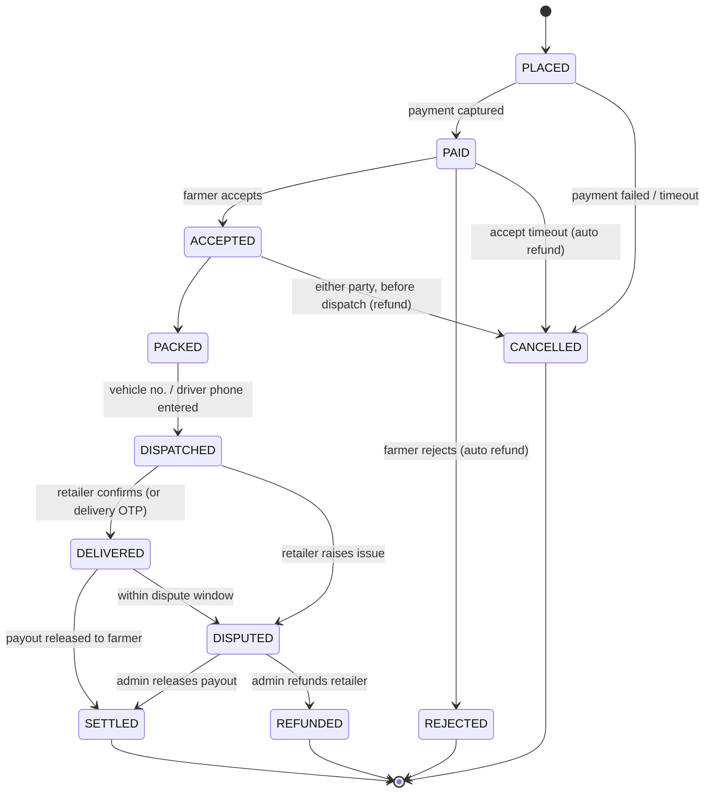
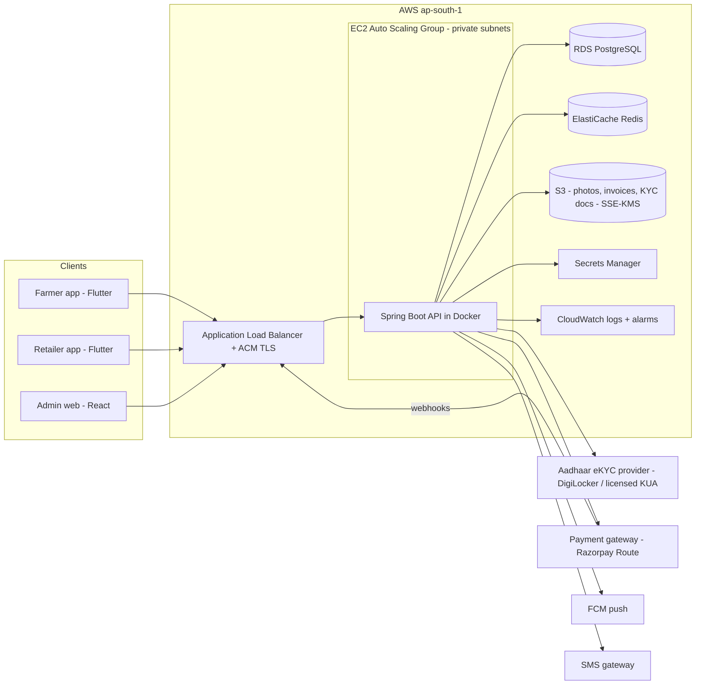
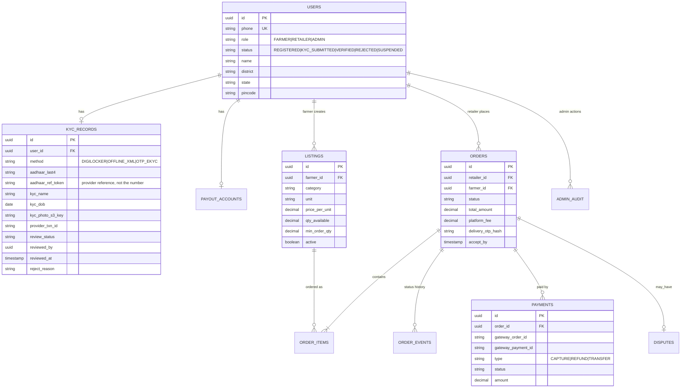
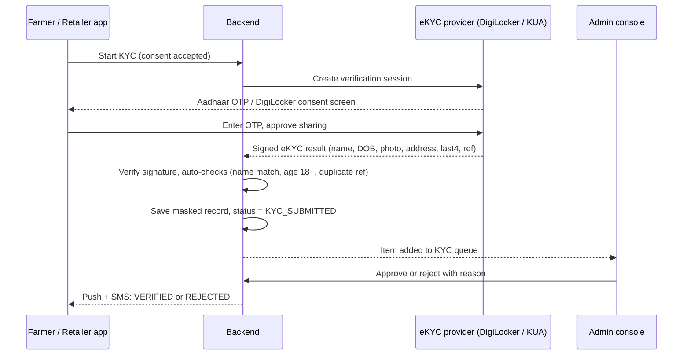

# Blueprint: Farmer–Retailer Order Management App ("KrishiLink", working name)

| Item | Value |
|---|---|
| Version | 0.2 (refined MVP blueprint) |
| Scope | Minimum viable product: onboarding + Aadhaar verification, catalogue, orders, tracking, payments, admin |
| Clients | Android/iOS mobile app (farmers, retailers) + web admin console |
| Hosting | AWS EC2 (ap-south-1, Mumbai) |
| Status | Proposed – open questions in section 13 |

---

## 1. Problem and goals

Farmers sell produce to retailers through middlemen, with no order record, no delivery visibility and delayed payment. The MVP gives both parties one app to:

1. Register and get **verified by an admin using Aadhaar** (trust between unknown buyers/sellers).
2. **List produce** (farmer) and **place orders** (retailer).
3. **Track** each order from placement to delivery.
4. **Pay online** (UPI/cards/net banking), with money released to the farmer after delivery is confirmed.

Out of scope for MVP: logistics partner integration, bidding/auctions, credit/loans, multi-language voice UI, analytics dashboards, chat. (See section 12, Roadmap.)

## 2. Users and roles

| Role | Can do |
|---|---|
| **Farmer** | Register, submit KYC, add bank/UPI payout details, manage produce listings (price, quantity, unit, harvest date, photos), accept/reject orders, mark dispatched, view payouts |
| **Retailer** | Register, submit KYC (+ optional GSTIN/shop licence), browse/search listings, place orders, pay, track, confirm delivery, raise a dispute |
| **Admin** | Review KYC queue, approve/reject/suspend users, view all orders/payments, resolve disputes, trigger refunds, manage produce categories |

Rule: **a user cannot list or order until their status is `VERIFIED`.** Unverified users can only browse.

## 3. MVP feature list

### 3.1 Onboarding and verification
- Mobile number login with OTP (no passwords).
- Profile: name, role, address, village/district/state, PIN code, geo-location (optional).
- Aadhaar eKYC (see section 6) → status `KYC_SUBMITTED`.
- Admin review → `VERIFIED` / `REJECTED` (with reason) / `SUSPENDED`.
- Farmer payout account: bank account + IFSC or UPI ID, validated by penny-drop through the payment gateway.

### 3.2 Catalogue (farmer)
- Create/edit/deactivate listing: category, variety, grade, unit (kg/quintal/crate), price per unit, available quantity, minimum order quantity, pickup location, up to 3 photos.
- Stock is decremented (reserved) when an order is accepted, released if cancelled.

### 3.3 Orders (retailer ↔ farmer)
- Retailer searches by category, district/distance, price; adds quantity; places order (single farmer per order in MVP – keeps payment split simple).
- Farmer accepts or rejects within a time window (e.g. 12 h, configurable); auto-cancel + refund on timeout.
- Cancellation rules: retailer may cancel before dispatch; farmer may cancel before dispatch (counts against farmer rating).

### 3.4 Tracking
Status timeline visible to both parties, with timestamp and actor for every change, plus push/SMS notification:

- **Delivery proof:** a 4-digit delivery OTP shown to the retailer; the farmer/driver enters it on hand-over → `DELIVERED`. Fallback: retailer taps "Received". Auto-confirm after N hours (e.g. 48 h) if no dispute.
- MVP tracking is **status-based**, not live GPS. Optional: farmer shares vehicle number and driver phone at dispatch.

### 3.5 Payments
- **Gateway:** Razorpay (with **Route** for marketplace split/hold) – alternatives Cashfree Easy Split, PhonePe PG. Pick one with marketplace/escrow-style settlement; Razorpay assumed below.
- Flow: retailer pays full order amount → funds held on the platform's linked account → on `DELIVERED` (+ dispute window) a transfer is released to the farmer's linked account minus platform fee.
- Methods: UPI (primary), cards, net banking. Cash on delivery **not** in MVP.
- Webhooks (`payment.captured`, `payment.failed`, `refund.processed`, `transfer.processed`) are the source of truth; the app never marks an order paid from the client callback alone. Webhook signature verified; handlers idempotent (keyed on gateway event ID).
- Refunds triggered automatically on reject/cancel/timeout, or by admin on dispute.
- Daily reconciliation job: compare gateway settlement report with `payments` table, flag mismatches to admin.
- Invoice PDF per order (GST fields left optional for MVP; fresh unprocessed produce is generally GST-exempt – confirm with finance).

### 3.6 Admin console (web)
- KYC queue with filters (role, district, submitted date), side-by-side view of profile vs eKYC response (name, masked Aadhaar, photo, address), approve/reject with reason.
- User management: suspend/reactivate, view history.
- Orders and payments search, dispute queue, manual refund/release.
- Audit log of every admin action (who, what, when, before/after).

### 3.7 Notifications
- Push (Firebase Cloud Messaging) for every order status change; SMS fallback (e.g. MSG91 / AWS SNS with DLT-registered templates) for OTP and critical events.

## 4. Architecture

Modular monolith for MVP (one deployable backend, clear modules) – cheapest to run and operate on EC2; modules can be split later if load demands.

### 4.1 Tech stack

| Layer | Choice | Why |
|---|---|---|
| Mobile app | **Flutter** (one codebase, Android first) | Low-end Android devices dominate rural users; single codebase for both roles (role-based screens) |
| Admin web | React + Vite, served from S3 + CloudFront (or Nginx on the same EC2) | Team already uses React |
| Backend | **Java 17, Spring Boot 3**, Spring Security (JWT), Spring Data JPA, Flyway | Matches team skills from existing capstone repos |
| Database | PostgreSQL 16 on **RDS** (Multi-AZ optional in MVP) | Relational order/payment data, transactions |
| Cache / jobs | Redis (OTP, rate limits, idempotency keys, ShedLock for scheduled jobs) | |
| Files | S3 (private bucket, pre-signed URLs) | Photos, invoices, KYC artefacts |
| Notifications | FCM + SMS gateway | |
| CI/CD | GitHub Actions → build Docker image → push to ECR → deploy to EC2 (SSM Run Command or CodeDeploy) | |
| IaC | Terraform (or CloudFormation) | Repeatable environments |

### 4.2 Backend modules
`auth` (OTP, JWT, roles) · `user-kyc` (profiles, Aadhaar eKYC, admin review) · `catalogue` · `order` (state machine, timers) · `payment` (gateway client, webhooks, refunds, payouts, reconciliation) · `notification` · `admin` (audit log, disputes) · `common` (errors, i18n, file storage).

## 5. Data model (core tables)

Money stored as `NUMERIC(12,2)` in INR; all status changes written to `order_events` in the same transaction (append-only history = tracking timeline + audit).

## 6. Aadhaar verification (admin-reviewed)

### 6.1 Legal constraints (must be reviewed by legal/compliance before build)
- Under the Aadhaar Act, 2016 (as amended 2019) and UIDAI regulations, a private platform **cannot call UIDAI authentication directly** unless it is (or uses) a UIDAI-licensed AUA/KUA permitted for that purpose. Aadhaar-based KYC for a private marketplace must be **voluntary**, and an alternative ID must be offered.
- **Never store the full 12-digit Aadhaar number**, biometrics, or the raw eKYC XML beyond what the regulations allow. Store only: last 4 digits, the provider reference/token, verified name/DOB/photo/address needed for review. If the full number must be stored, it has to go into an **Aadhaar Data Vault** (encrypted, HSM-backed keys, tokenised) – avoid this in MVP.
- Capture explicit **consent** (purpose, data used, retention) before verification; log the consent with timestamp.
- Comply with India's **DPDP Act, 2023** (purpose limitation, retention, user deletion requests).

### 6.2 Recommended approach (choose one provider in section 13)
| Option | How it works | Fit |
|---|---|---|
| **A. DigiLocker "Pull Aadhaar"** (via DigiLocker partner API or a KYC vendor) | User logs into DigiLocker with Aadhaar OTP, consents; app receives UIDAI-signed Aadhaar data | **Recommended** – UIDAI-signed data, user-consented, no Aadhaar number handled by us |
| B. Aadhaar Paperless Offline e-KYC | User downloads share-code-protected XML (or scans Secure QR) from UIDAI and uploads it; backend verifies UIDAI signature | Good fallback; no third-party fee, slightly harder UX |
| C. OTP eKYC through a licensed KUA vendor (e.g. KYC API providers) | User enters Aadhaar no. + OTP in vendor SDK; vendor returns eKYC data | Simplest UX; per-call cost; vendor holds the licence |

Alternative ID (to keep Aadhaar voluntary): PAN or Voter ID upload, reviewed manually by admin.

### 6.3 Verification flow

Auto-checks before admin review: name fuzzy-match with profile, age ≥ 18, **duplicate detection** on the provider reference token (one Aadhaar = one account per role), PIN code consistency. Retailers optionally add GSTIN (validated via GST API) for a "GST verified" badge.

## 7. API surface (REST, JSON, `/api/v1`)

| Area | Endpoints (abridged) |
|---|---|
| Auth | `POST /auth/otp/request`, `POST /auth/otp/verify` → JWT access (15 min) + refresh token |
| Profile/KYC | `GET/PUT /me`, `POST /kyc/sessions`, `POST /kyc/callback`, `GET /kyc/status`, `PUT /me/payout-account` |
| Catalogue | `GET /listings?category&district&near`, `POST/PUT/DELETE /listings/{id}` (farmer) |
| Orders | `POST /orders`, `GET /orders`, `GET /orders/{id}` (incl. timeline), `POST /orders/{id}/accept|reject|pack|dispatch|deliver|cancel|dispute` |
| Payments | `POST /orders/{id}/payment` (create gateway order), `POST /webhooks/razorpay` (public, signature-verified) |
| Admin | `GET /admin/kyc?status=`, `POST /admin/kyc/{id}/approve|reject`, `POST /admin/users/{id}/suspend`, `GET /admin/orders`, `POST /admin/disputes/{id}/resolve`, `GET /admin/audit` |

All state-changing endpoints accept an `Idempotency-Key` header; transitions are validated server-side against the state machine and role (e.g. only the order's farmer can `dispatch`).

## 8. Security

- OTP login with rate limits (per phone/IP) and lockout; JWT signed with a key from Secrets Manager; refresh-token rotation.
- Role-based + ownership authorization on every endpoint; admin console behind separate admin role + mandatory TOTP 2FA, optionally IP allow-list.
- TLS everywhere (ACM cert on ALB); EC2 and RDS in private subnets; only ALB public; SSH disabled – access via **SSM Session Manager**.
- S3 private, SSE-KMS; KYC photos accessed only via short-lived pre-signed URLs from the admin console; RDS encrypted at rest; PII columns (KYC name/DOB/address) additionally encrypted at application level.
- AWS WAF on the ALB (rate-based rule, common rule set); webhook endpoint accepts only valid gateway signatures.
- No secrets in code or images – Secrets Manager / SSM Parameter Store, read via the EC2 instance role.
- OWASP dependency check + container image scan (ECR scan / Trivy) in CI.
- PCI-DSS scope minimised: card data never touches our servers (gateway checkout SDK).

## 9. Deployment on AWS EC2

### 9.1 Topology (production)

| Component | Spec (MVP starting point) |
|---|---|
| VPC | 2 AZs; public subnets (ALB, NAT gateway), private subnets (EC2, RDS, Redis) |
| ALB | HTTPS 443 with ACM certificate; HTTP→HTTPS redirect; health check `/actuator/health` |
| EC2 | Auto Scaling Group, **min 2 / max 4**, `t3.medium` (or Graviton `t4g.medium`), Amazon Linux 2023, Docker; scale on CPU > 60% |
| RDS PostgreSQL | `db.t4g.medium`, 50 GB gp3, automated backups 7 days, Multi-AZ when live |
| ElastiCache Redis | `cache.t4g.micro` (or Redis container on EC2 for dev) |
| S3 + CloudFront | Admin web static hosting, produce photos |
| ECR | Backend images |
| Route 53 | `api.<domain>`, `admin.<domain>` |
| CloudWatch | Agent for logs/metrics, alarms → SNS email/Slack (5xx rate, p95 latency, CPU, RDS storage, failed webhooks) |

**Low-cost dev/staging:** a single `t3.small` EC2 running Docker Compose (API + PostgreSQL + Redis + Nginx with Let's Encrypt). Same images as prod.

### 9.2 CI/CD pipeline (GitHub Actions)
1. On PR: build, unit + integration tests (Testcontainers PostgreSQL), lint, coverage gate, OWASP/Trivy scan.
2. On merge to `main`: build Docker image tagged with git SHA → push to ECR → deploy to **staging** via SSM Run Command (`docker pull` + restart) or CodeDeploy → smoke tests.
3. Manual approval → **production** rolling deploy (ASG instance refresh / CodeDeploy rolling, ALB health checks gate traffic). Rollback = redeploy previous SHA.
4. DB migrations by Flyway on app start (backward-compatible migrations only).
5. Mobile: Flutter build in CI → Play Store internal testing track (Fastlane); iOS later.

### 9.3 Operations
- Backups: RDS automated snapshots + weekly manual snapshot; S3 versioning on KYC/invoice buckets.
- Targets: availability 99.5% (MVP), RPO ≤ 24 h → 5 min with PITR, RTO ≤ 4 h.
- Logs retained 30 days (PII masked in logs – never log Aadhaar data, OTPs or tokens).

## 10. Non-functional requirements

| Concern | MVP target |
|---|---|
| Load | 5k registered users, 200 concurrent, ~2k orders/day |
| Latency | p95 < 500 ms for API reads, < 1 s for order placement |
| Low connectivity | App caches catalogue and own orders offline; retries with idempotency keys; images compressed client-side |
| Languages | English + Hindi at launch; strings externalised for regional languages |
| Accessibility | Large touch targets, icons + text, minimal typing (pickers) for low-literacy users |
| Sustainability | Graviton (ARM) instances, ASG scales in off-peak (night), push notifications instead of client polling, S3 lifecycle to Glacier for old invoices/photos, right-size via CloudWatch after first month |

## 11. Indicative monthly AWS cost (production MVP, ap-south-1, on-demand, approx.)

| Item | ~USD/month |
|---|---|
| 2 × t3.medium EC2 | 60 |
| ALB | 20–25 |
| RDS db.t4g.medium single-AZ + 50 GB | 55–70 (≈ 2× for Multi-AZ) |
| ElastiCache t4g.micro | 12–15 |
| NAT gateway | 35–45 |
| S3, CloudFront, CloudWatch, Route 53, Secrets Manager | 15–30 |
| **Total** | **≈ 200–250** (dev/staging single EC2: ≈ 20–30) |

Figures are estimates for planning only – confirm with the AWS Pricing Calculator. Payment gateway (~2% per transaction; UPI pricing varies) and eKYC per-verification fees are extra.

## 12. Delivery plan

| Phase | Weeks | Deliverables |
|---|---|---|
| 0. Foundations | 1–2 | Repo, CI/CD, Terraform VPC/EC2/RDS, auth (OTP + JWT), staging environment live |
| 1. Onboarding + KYC | 3–4 | Profiles, eKYC provider integration (sandbox), admin KYC queue, payout account validation |
| 2. Catalogue + Orders | 5–6 | Listings, search, order state machine, notifications, timeline UI |
| 3. Payments | 7–8 | Gateway checkout, webhooks, refunds, Route transfers to farmers, reconciliation job |
| 4. Hardening + launch | 9–10 | Security review, load test (k6), legal sign-off on Aadhaar flow, Play Store release, prod cut-over |

**Post-MVP roadmap:** logistics partner integration with live GPS, ratings/reviews, multi-farmer cart, price trends (Agmarknet data), credit/BNPL for retailers, regional-language voice search, iOS release.

## 13. Open questions / decisions needed

1. **eKYC provider:** DigiLocker (via which partner) vs offline XML vs a licensed KUA vendor – needs commercial + legal sign-off.
2. **Payment gateway:** Razorpay Route vs Cashfree Easy Split; platform fee % and who bears gateway charges.
3. **Dispute window** length and auto-confirm delay (proposed 48 h).
4. **Delivery:** who arranges transport in MVP – farmer, retailer, or either (proposed: either; platform only records it)?
5. **Mobile framework:** Flutter (proposed) vs React Native if the team prefers JS.
6. **Launch region and languages** (drives SMS templates, translations, and data residency – ap-south-1 assumed).
7. **Domain name** and Play Store developer account ownership.

## 14. Key risks

| Risk | Impact | Mitigation |
|---|---|---|
| Aadhaar handling non-compliant | Legal/regulatory action | Use licensed provider/DigiLocker, store masked data only, consent logging, legal review before launch |
| Payment state drift (client says paid, gateway says not) | Wrong deliveries/payouts | Webhooks as source of truth, idempotent handlers, daily reconciliation |
| Fake or duplicate accounts | Fraud | Aadhaar ref-token de-duplication, admin review, penny-drop on payout accounts, suspend flow |
| Poor rural connectivity | Failed orders, bad UX | Offline caching, idempotent retries, SMS fallback |
| Single-region EC2 outage | Downtime | Multi-AZ ASG + RDS Multi-AZ, tested restore runbook |
